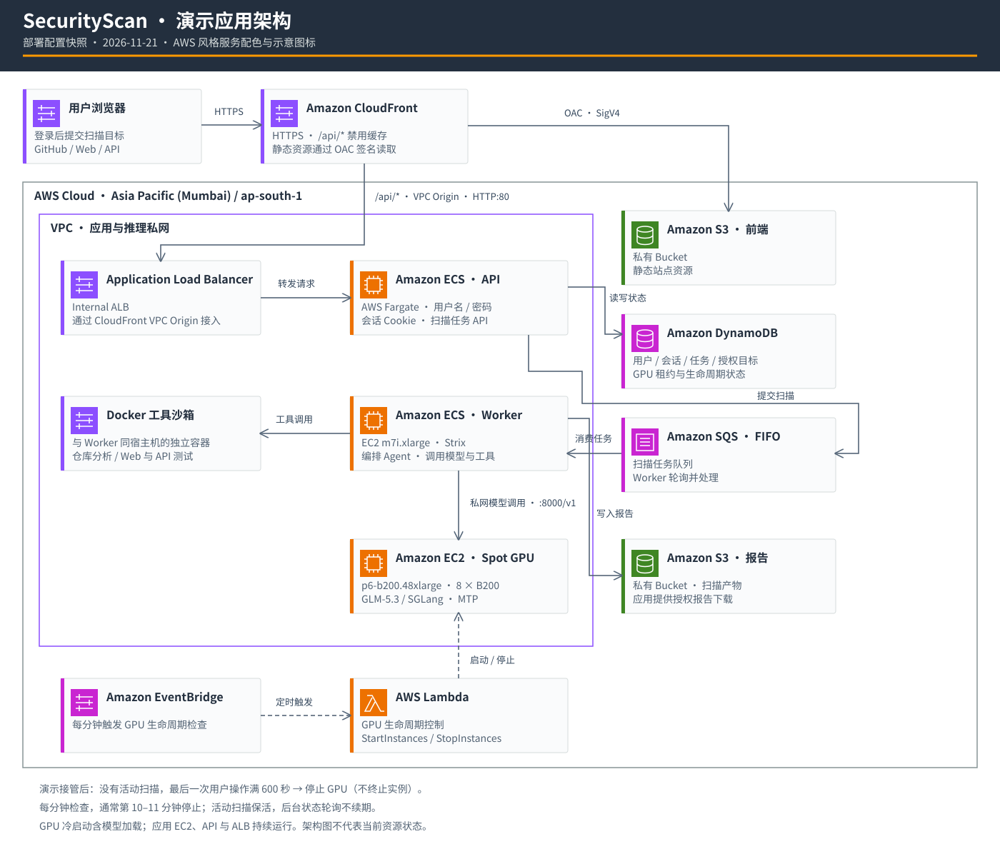
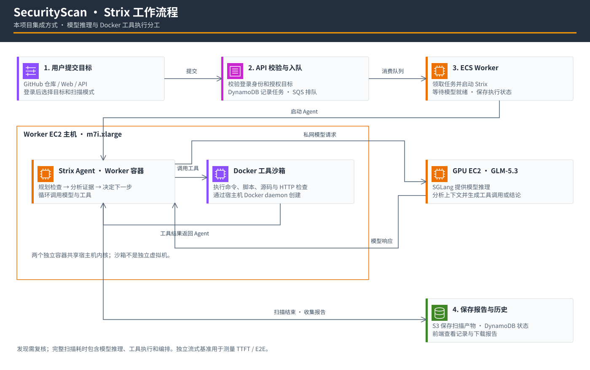
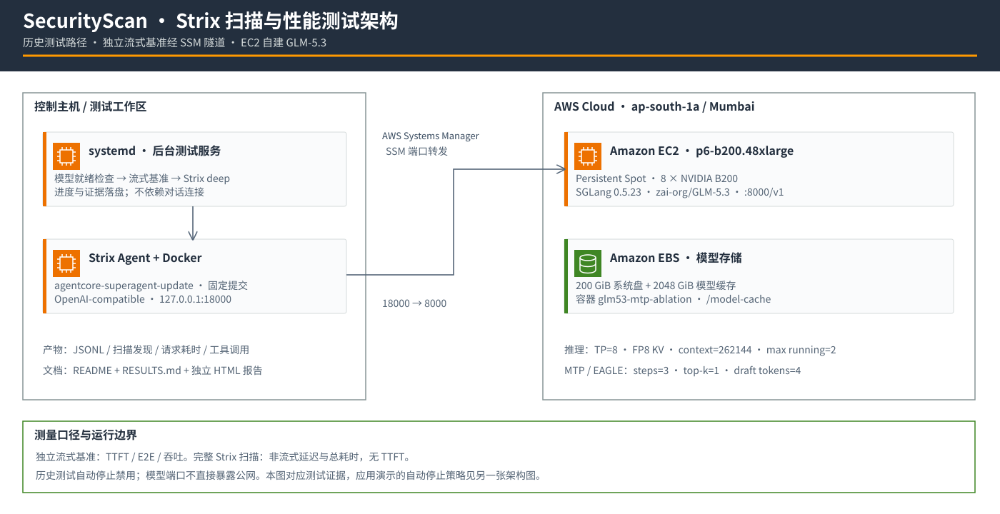

# SecurityScan

GLM-5.3 与 Strix 的安全测试、漏洞核验和推理性能记录，包含自建模型部署与大型仓库审计。

## Strix + GLM-5.3 实际扫描性能（2026-11-22 汇总）

**扫描推理机型：AWS EC2 `p6-b200.48xlarge`，单机 8×NVIDIA B200（ap-south-1）。** 使用自建 GLM-5.3、SGLang 0.5.23、TP=8 和 MTP；下表为已完成的 Strix deep 扫描，工具在独立沙箱运行。

| 扫描场景 | 扫描 E2E | 成功模型请求 / 总请求 | 工具调用 | 单次模型请求 E2E 均值 | 待核验发现 |
| --- | ---: | ---: | ---: | ---: | ---: |
| agentcore-superagent-update 完整仓库 | 704 秒（11 分 44 秒） | 637 / 637 | 611 | 4.001 秒 | 29 |
| AgentcoreShell deep | 120 秒（2 分钟） | 66 / 66 | 66 | 1.829 秒 | 1 |
| superagent 前端与部署专项 deep | 781 秒（13 分 1 秒） | 575 / 575 | 559 | 2.847 秒 | 28 |

扫描 E2E 是扫描任务总墙钟耗时，包含模型、工具和编排，**不包含 GPU 启动和模型加载**；单次请求 E2E 是一次模型调用从发出到完整响应的耗时。请求可能并行，不能将均值乘以请求数当作扫描总耗时。上述请求为非流式，**未测得扫描内 TTFT 或 TPOT**。请求成功率不代表漏洞验证准确率；发现可能重叠，不应相加为独立漏洞数。

证据：[完整仓库扫描](reports/glm53-superagent/full-20261121T033400Z/progress-summary.json)、[补充扫描](reports/glm53-additional-full/20261121T095600Z/progress.json)。

**H200 已完成的是独立流式推理基准，尚无完整 Strix 扫描成绩。** 机型为 `p5en.48xlarge`（8×NVIDIA H200，ap-northeast-1）。并发 1 / 2 时，请求 E2E 均值为 **13.740 / 15.407 秒**，TTFT 均值为 **0.140 / 0.184 秒**，聚合输出吞吐为 **203.93 / 341.99 tokens/s**（整台 8 卡实例）。共 24 次正式请求，另有 4 次预热请求不计入统计。B200 对应独立基准 E2E 为 10.220 / 11.111 秒；两组输出长度、调用路径和内核配置存在差异，不能据此推断纯硬件速度差异。详见 [H200/B200 对照报告](reports/glm53-h200-comparison/README.md)。

## 本地部署与运行

参见 [本地部署指南](docs/local-deployment.md)：安装 Strix、在 GPU 主机启动 GLM-5.3、连接模型、扫描本地代码/GitHub/Web/API，以及查看报告。已有模型服务时，运行 Strix 的电脑无需 GPU。

网页控制台的前端可本地开发；完整控制台仍依赖 AWS 后端资源，详见指南中的运行范围说明。

## 最新测试结论（2026-11-21）

**完整 Strix deep 扫描已完成，用时 704 秒（11 分 44 秒）；637/637 次模型请求成功，611 次工具调用。** 单次模型请求平均延迟为 **4.001 秒**。生成 **29 条待独立核验发现**：Critical 6、High 6、Medium 12、Low 4、Info 1。退出码 2 表示发现达到 fail-on 阈值；产物状态为 `completed`，不是模型调用失败。

目标为 `agentcore-superagent-update` 的固定提交 `0a20b8b14ab9abdf7301ec1e475be2d6dc2effde`。完成时间为 **2026-11-21 04:15 UTC**，运行 ID 为 `agentcore-superagent-update_e35b`。704 秒不包含模型加载（本次约 25 分钟）。发现尚未逐项核验，也不能与历史 32 条直接相加为独立漏洞数。

### 演示应用部署架构



前端由私有 S3 + CloudFront OAC 提供；用户先以用户名、密码登录。`/api/*` 通过 CloudFront VPC Origin 转发至内部 ALB 和 ECS Fargate API，任务进入 SQS FIFO，由 ECS EC2 Worker 运行 Strix 与 Docker 工具沙箱。Worker 通过私网调用 Spot GPU 上的 GLM-5.3，扫描产物写入私有 S3；DynamoDB 保存账户、会话、任务、授权目标及 GPU 租约。

演示接管 GPU 后，EventBridge 每分钟触发 Lambda 检查空闲状态。没有活动扫描时，最后一次用户操作满 600 秒后执行 `StopInstances`，通常在第 10–11 分钟停止；后台状态轮询不会延长租约。活动扫描保活，显式结束演示或最后任务结束后的空闲倒计时为 10 分钟。停止保留实例和 EBS。模型加载需要单独等待，历史一次冷启动约 25 分钟，Spot 启动受容量影响。此图依据 2026-11-21 部署配置和记录绘制，不表示实时运行状态；历史测试结果与当前应用验证记录分别记录。

架构图使用 AWS 服务分类配色和自绘矢量图标；应用推理走私网，以下历史性能测试走 SSM 隧道。HTML 内嵌 SVG，可离线查看。更新图表可运行 `python3 scripts/render_architecture.py`，然后运行 `uv run scripts/render_report.py`。

### Strix 工作原理与工具沙箱



Strix 是由大模型驱动的安全测试 Agent。它根据目标规划检查步骤，调用工具收集证据，将执行结果交给模型分析，再决定下一步测试，最后生成报告。本项目由 ECS Worker 启动 Strix；GLM-5.3 通过 GPU 实例上的 SGLang 服务提供推理。

| 组件 | 在本项目中的职责 |
| --- | --- |
| Strix / ECS Worker | 消费队列任务、组织 Agent 执行、调用模型与工具、收集报告 |
| Docker 工具沙箱 | 执行源码读取、命令、脚本和网络测试；工具的实际执行环境 |
| GLM-5.3 / GPU EC2 | 分析上下文并生成下一步工具调用或结论；模型服务与工具执行分开 |
| API / DynamoDB / S3 | 校验用户与目标、保存任务和历史状态、提供报告下载 |

**工具沙箱是 Docker 容器。** Worker 通过宿主机 Docker daemon 创建沙箱，Worker 容器和沙箱是同一 EC2 主机上的独立容器；它不是独立虚拟机，也不运行在 GPU 实例内。容器提供工具依赖和进程、文件系统隔离，但共享宿主机内核。本演示环境适合受信任管理员使用；目标授权列表不是完整的网络出口隔离。

支持的任务入口包括 GitHub 仓库、Web 和 API：仓库扫描分析源码中的认证、权限、输入处理和依赖使用；Web/API 测试根据目标和可用上下文执行 HTTP 交互与漏洞验证。具体覆盖范围取决于目标可达性、工具、凭据和执行预算，不能保证每次扫描覆盖全部漏洞类型。目前没有私有仓库凭证或专用 API 凭证输入表单。

用户登录后提交授权目标，API 校验并入队；Worker 等待并调用模型，在沙箱中循环执行测试，结束后保存报告。关闭页面不会取消后台任务。管理员可在前端“授权目标”中管理仓库与 Web/API 主机列表，配置保存到 DynamoDB；其他用户无修改权限。

报告中的发现需要独立复核。扫描总耗时包含模型、工具和编排开销；当前完整扫描使用非流式模型请求，不能从中得到 TTFT。本文的流式 TTFT/E2E 数值来自独立基准。

参考：[Strix CLI](https://docs.strix.ai/usage/cli)、[Strix 文档索引](https://docs.strix.ai/llms.txt)。上图描述本项目集成方式。

### 本轮测试部署架构



SGLang 0.5.23 自建服务启用 MTP（EAGLE，steps=3、top-k=1、draft tokens=4），TP=8、FP8 KV cache、context=262144、并行请求上限 2。控制主机通过 SSM 将本机 18000 转发到 GPU 8000；后台 systemd 服务将进度和证据落盘。本轮测试时 GPU 保持运行，自动停止已禁用；[资源记录](reports/glm53-superagent/resource-status.json)中的 `running` 是带时间戳的观察值。

### 最新独立流式性能（MTP，经过 SSM）

| 并发 | 成功请求 | TTFT 均值 / P95（秒） | 首次正文均值（秒） | E2E 均值 / P95（秒） | 估算 TPOT 均值（毫秒） | 聚合输出 tokens/s |
| --- | ---: | ---: | ---: | ---: | ---: | ---: |
| 1 | 12/12 | 0.325 / 0.372 | 4.353 | 10.220 / 18.186 | 3.653 | 263.3 |
| 2 | 12/12 | 0.337 / 0.423 | 4.973 | 11.111 / 17.318 | 4.209 | 447.5 |

认证、路径、Webhook、工具四类源码审计，每类每并发重复 3 次，输出预算 8192、reasoning=low；24 次请求均无错误、截断或仅思考输出。并发 2 提高聚合吞吐，但单请求平均 E2E 略增。TTFT 取首个非空 reasoning/content/tool 增量，首次正文单列；E2E 从请求发出计至完整响应流结束。吞吐包含思考 tokens。

**完整 Strix 扫描采用非流式请求，没有 TTFT 测量；上表是独立基准，不能当作完整扫描指标。** 每档仅 12 个样本，P95 仅供参考；与历史实验及 InferenceX 的预算、缓存、硬件和负载不一致，不能直接排名或据此计算 MTP 加速比。Codex 对话断流仍未证实修复。

证据：[完整扫描摘要](reports/glm53-superagent/full-20261121T033400Z/README.md)、[结构化汇总](reports/glm53-superagent/full-20261121T033400Z/progress-summary.json)、[流式指标](reports/glm53-superagent/full-20261121T033400Z/stream-metrics-public.jsonl)。

### 补充完整扫描（2026-11-21）

| 场景 | 扫描耗时（秒） | 成功模型请求 | 工具调用 | 请求平均 / P95（秒） | 待核验发现 |
| --- | ---: | ---: | ---: | ---: | ---: |
| AgentcoreShell deep | 120 | 66/66 | 66 | 1.829 / 4.511 | 1 |
| Superagent 前端与部署 | 781 | 575/575 | 559 | 2.847 / 8.985 | 28 |

两次扫描均完成，采用自建 GLM-5.3、TP8 和 MTP，顺序执行。请求延迟为非流式调用的 E2E，无法从中推导 TTFT；发现尚未独立核验，不与其他扫描相加为独立漏洞总数。详见[补充扫描摘要](reports/glm53-additional-full/20261121T095600Z/README.md)。

## 历史测试结论摘要（2026-11-20）

- **EC2 自建模型仓库审计**：使用 `zai-org/GLM-5.3`、SGLang、`p6-b200.48xlarge`（8×B200，ap-south-1 Spot），扫描 [agentcore-superagent-update](https://github.com/milan9527/agentcore-superagent-update/tree/0a20b8b14ab9abdf7301ec1e475be2d6dc2effde)。本轮不是 Bedrock 托管调用。
- **四个 Strix 场景完成**：认证、路径、Webhook、工具，共 770 次成功模型请求，产生 **32 条原始待核验发现**，含重复项。四次退出码均为 2，完成依据是扫描产物的 `scan_completed=true`。
- **核验结果**：WebSocket 未鉴权订阅在原始网关的隔离本地环境复现，仅使用已知合成 ID 和事件；没有证明公网部署可利用。ZIP 路径穿越在 Python 3.9.25 测试分支未复现，与模型报告主张矛盾。其余发现仍待独立验证。
- **输出预算与稳定性**：独立流式源码审计采用 32768 输出预算、low reasoning，40/40 请求正常结束且有正文，无错误、截断或仅思考输出；这不代表漏洞结论正确，也不保证更大任务永不耗尽预算。
- **对话断流仍未证实修复**：Codex 的 `stream closed before response.completed` 与自建 GLM 链路不同，不能用上述 40 次成功请求宣称修复。
- **历史资源收尾**：AWS 已确认 GPU 实例 `stopped`，两块 EBS 保留并继续产生存储费用。

### 新增独立对照：精简输出与 MTP

三组共 120/120 次正式请求完成，无错误或截断。下表为 GPU localhost 实测，每格 20 次；两项优化分别与同一新基线比较。

| 并发 | 基线 E2E 均值 | 精简输出 E2E 均值 | MTP E2E 均值 | MTP TPOT 降幅 |
| --- | ---: | ---: | ---: | ---: |
| 1 | 19.65 秒 | 15.78 秒（−19.7%） | 8.64 秒（−56.0%） | 57.6% |
| 2 | 19.64 秒 | 17.24 秒（−12.2%） | 9.89 秒（−49.6%） | 53.2% |

MTP 明显加速生成，但并发 2 TTFT p95 从 0.115 秒升至 0.930 秒。精简指令主要减少思考 tokens，正文字符数反而增加约 35%–37%。抽查 24 份回答仍发现错误和前提遗漏，不能声称质量无损。本轮为源码审计推理对照，没有测完整 Strix 工具循环的加速比。详见 [实验协议](reports/glm53-superagent/ABLATION-PROTOCOL.md) 与 [质量核验](reports/glm53-superagent/ABLATION-QUALITY.md)。该历史实验完成后 GPU 曾停止；2026-11-21 本轮测试时已重新启动并保持运行。

### 历史流式测试（SSM 隧道）

| 并发 | 正式请求 | TTFT p50 / p95（秒） | 首次正文 p50 / p95（秒） | E2E p50 / p95（秒） | 聚合输出 tokens/s |
| --- | ---: | ---: | ---: | ---: | ---: |
| 1 | 20 | 0.353 / 1.019 | 7.131 / 15.504 | 18.819 / 31.819 | 127.19 |
| 2 | 20 | 0.339 / 0.400 | 7.330 / 18.137 | 19.135 / 37.275 | 236.18 |

TTFT 包含首个思考/内容/工具增量；首次正文单列。吞吐量包含思考 tokens，按批次总输出除以墙钟时间计算。测试经过 SSM 隧道，重复输入可能命中缓存，每个并发档仅 20 个样本；与 InferenceX 协议不同，不能直接比较排名。Strix 非流式扫描未测 TTFT，上表来自另外的只读源码审计请求。

完整环境、指标定义、限制与证据见 [详细测试报告](reports/glm53-superagent/RESULTS.md)；[HTML 报告](reports/glm53-superagent/index.html) 可下载后在浏览器打开（GitHub 文件页通常显示源码，未配置 Pages）。

### H200 与 B200 对照（2026-11-22）

东京 Spot `p5en.48xlarge`（8×H200）已完成 GLM-5.3 工具调用验证及 24 个正式流式审计请求，无错误或截断。并发 1 / 2 的平均 E2E 为 **13.740 / 15.407 秒**，聚合输出吞吐为 **203.9 / 342.0 tokens/s**；相比此前 B200，吞吐低约 23%，E2E 长约 34%–39%。测试网络路径、输出长度和 H200 内核调优配置存在差异，不能直接视为硬件性能差距。本轮是离线源代码审计推理对照，并非完整 Strix 扫描。

详见 [H200 对照报告与原始证据](reports/glm53-h200-comparison/README.md) 和 [HTML 报告](reports/glm53-h200-comparison/index.html)。

HTML 与 Markdown 共用报告源，重新生成：

```bash
uv run scripts/render_report.py
uv run scripts/render_gpu_comparison.py
```

本地虚拟环境、原始会话数据库及运行日志不提交。上游 Strix 的源码及许可证见 `strix-src` 子模块。
