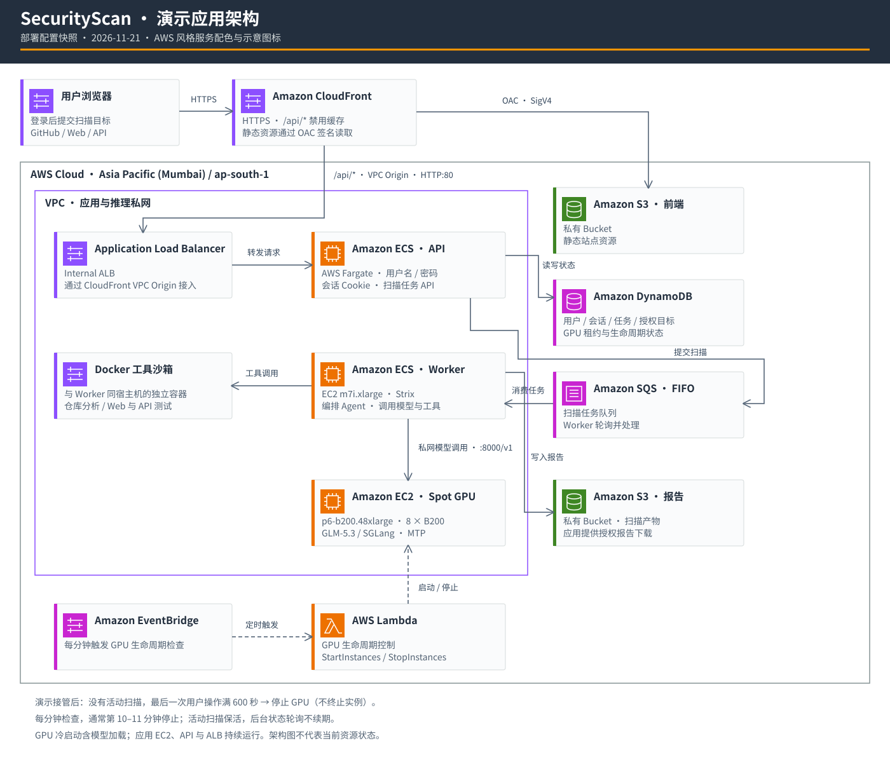
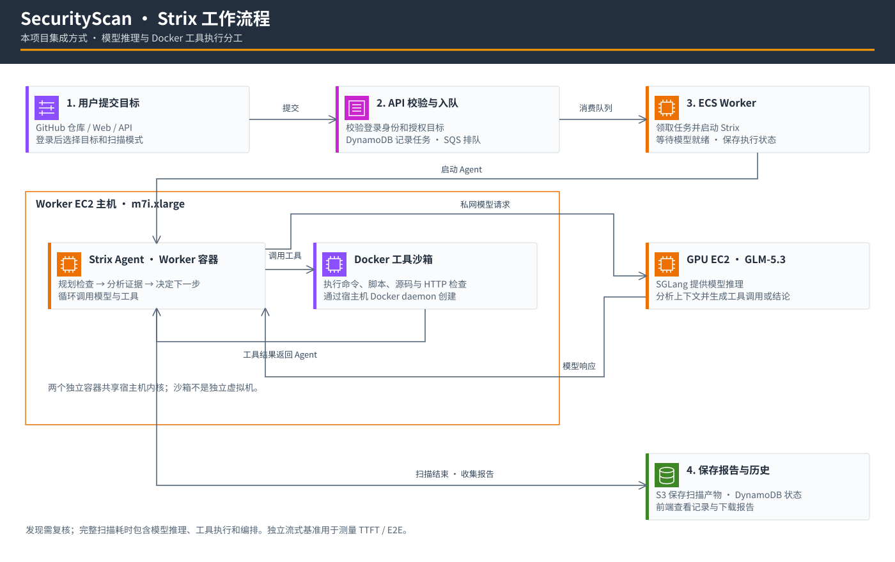

# Strix Security Console

独立前后端的安全测试演示应用。支持 GitHub 代码仓库扫描、Web 应用和 API 测试，提供任务状态、待核验发现和完整报告下载。扫描通过 Strix 调用私有 GLM 5.3 服务。

本地 Strix 安装、GPU 模型启动、目标扫描及前端开发命令见 [本地部署指南](../../docs/local-deployment.md)。前端开发服务器只提供 UI；完整控制台依赖下述 AWS 后端资源。



前端经 CloudFront OAC 读取私有 S3；API 经 VPC Origin、内部 ALB 到达 ECS Fargate。SQS FIFO 将任务交给独立 EC2 上的 Strix Worker，GPU 仅提供私网模型推理。DynamoDB 保存用户、会话、任务及授权配置，私有 S3 保存报告。

## Strix 工作原理与工具沙箱



Strix 是由大模型驱动的安全测试 Agent。它根据目标规划检查步骤，调用工具收集证据，将执行结果交给模型分析，再决定下一步测试，最后生成报告。本项目由 ECS Worker 启动 Strix；GLM-5.3 通过 GPU 实例上的 SGLang 服务提供推理。

| 组件 | 在本项目中的职责 |
| --- | --- |
| Strix / ECS Worker | 消费队列任务、组织 Agent 执行、调用模型与工具、收集报告 |
| Docker 工具沙箱 | 执行源码读取、命令、脚本和网络测试；工具的实际执行环境 |
| GLM-5.3 / GPU EC2 | 分析上下文并生成下一步工具调用或结论；模型服务与工具执行分开 |
| API / DynamoDB / S3 | 校验用户与目标、保存任务和历史状态、提供报告下载 |

**工具沙箱是 Docker 容器。** Worker 通过宿主机 Docker daemon 创建沙箱，Worker 容器和沙箱是同一 EC2 主机上的独立容器；它不是独立虚拟机，也不运行在 GPU 实例内。容器提供工具依赖和进程、文件系统隔离，但共享宿主机内核。本演示环境适合受信任管理员使用；目标授权列表不是完整的网络出口隔离。

支持的任务入口包括 GitHub 仓库、Web 和 API：仓库扫描分析源码中的认证、权限、输入处理和依赖使用；Web/API 测试根据目标和可用上下文执行 HTTP 交互与漏洞验证。具体覆盖范围取决于目标可达性、工具、凭据和执行预算，不能保证每次扫描覆盖全部漏洞类型。目前没有私有仓库凭证或专用 API 凭证输入表单。

用户登录后提交授权目标，API 校验并入队；Worker 等待并调用模型，在沙箱中循环执行测试，结束后保存报告。关闭页面不会取消后台任务。管理员可在前端“授权目标”中管理仓库与 Web/API 主机列表，配置保存到 DynamoDB；其他用户无修改权限。

报告中的发现需要独立复核。扫描总耗时包含模型、工具和编排开销；当前完整扫描使用非流式模型请求，不能从中得到 TTFT。[性能报告](../../reports/glm53-superagent/RESULTS.md)中的流式 TTFT/E2E 数值来自独立基准。

参考：[Strix CLI](https://docs.strix.ai/usage/cli)、[Strix 文档索引](https://docs.strix.ai/llms.txt)。上图描述本项目集成方式。


## 演示流程

1. 登录工作空间，点击“启动演示”。控制器启动已有 Spot GPU，页面分别显示实例运行状态和模型就绪状态。
2. 模型就绪后，选择授权目标与扫描深度，确认测试授权并提交任务。
3. 扫描在后台串行执行；关闭网页不会取消扫描。报告保存在私有 S3，通过短期签名链接下载。
4. 点击“结束演示”。所有演示会话和扫描结束后，等待 10 分钟停止 GPU。控制器每分钟检查一次，因此实际停止时间可能再延迟约一分钟。

真实用户操作续期 600 秒演示租约，后台状态轮询不续期。没有活动扫描时，最后操作后约 10–11 分钟停止 GPU；关闭浏览器不会额外再叠加十分钟。默认最多三个在途任务，每次 Strix 执行最长 60 分钟。实例停止保留 EBS；再次启动可能受到 Spot 容量影响，模型也需要预热。

新部署的控制器初始状态为 `unmanaged`，不会接管或停止已运行的 GPU。首次点击启动演示后才管理该实例。控制器只了解本应用的任务，不会识别外部脚本启动的扫描；接管前应确认这些任务已结束。

## 部署

当前使用孟买 `ap-south-1`，复用 GPU `i-0b33a1d2ee1a2065f`（8 × NVIDIA B200）。API 使用 Fargate，Strix Worker 使用独立 ECS EC2 主机；Worker 并不是 GPU 实例。GPU 上 Docker 已配置开机启动，模型容器的重启策略为 `unless-stopped`。

- `infra/generate.py` 生成 `infra/template.json`。
- `Dockerfile.api`、`Dockerfile.worker` 分别构建 API 和 Worker 镜像。Worker 构建上下文必须为仓库根目录，以包含 `strix-src`。
- `buildspec.yml` 在 CodeBuild 中构建并推送两份镜像。
- `npm ci && npm test && npm run build` 构建前端。
- `npm run bundle:lambda` 生成 `build/index.js`，将其放在 ZIP 根目录并上传到模板参数指定的 S3 位置。
- CloudFormation 参数包括镜像、VPC/子网、现有 GPU 及其安全组、授权目标列表。部署需要 `CAPABILITY_IAM`。
- 将 `dist` 内容上传到输出 `FrontendBucket`，并写入 `config.json`：

```json
{}
```

CloudFront 输出 `Url` 即应用地址。更新固定名称的 HTML 后需失效 `/index.html` 和 `/`；构建后的 JS/CSS 文件名含内容哈希。`config.json` 不缓存。

使用应用自身的用户名密码登录，不依赖 Cognito。管理员账号 `admin` 已创建，密码通过部署主机上的受限凭据文件交付，不写入仓库。密码使用带随机盐的 scrypt 哈希，登录使用 Secure/HttpOnly/SameSite Cookie；会话有效期 8 小时，退出立即撤销，并限制登录尝试频率。账号与会话存储在 DynamoDB。默认允许 `milan9527/AgentcoreShell` 和 `milan9527/agentcore-superagent-update`；Web/API 目标初始默认为空。管理员可在前端“授权目标”中保存仓库（`owner/repo`）与主机名（可带端口，不含协议、路径或通配符），每类最多 100 项。配置保存至 DynamoDB 的 `CONFIG#TARGETS`；首次保存前使用部署参数 `AllowedHosts` 等初始配置，之后以前端保存的配置为准。

## 验证与限制

本地测试覆盖登录、会话撤销与到期、来源校验、登录限流，以及租约、停止倒计时、并发任务保护和目标校验；前端构建及 Lambda 打包已通过。线上部署和实际扫描的验证结果见 `DEPLOYMENT.md`，不要把本地测试视为端到端扫描成功。

扫描记录显示任务总耗时。原始 Strix 时间记录随报告下载；页面尚未汇总模型 TTFT/E2E，也不将扫描总耗时冒充推理延迟。发现需要人工复核，任务执行成功不代表没有漏洞。

Worker 通过宿主机 Docker 启动测试沙箱，适用于受信任管理员使用的演示环境。不要作为互不信任租户共享的生产服务。宿主机阻止沙箱访问 EC2/ECS 元数据地址；目标授权列表和 Strix 范围说明不等同于完整网络出口隔离。私有仓库凭证和专用 API 凭证表单尚未实现。登录令牌到期后需要重新登录。

## 参考

- [AWS Continuum 入门](https://docs.aws.amazon.com/continuum/latest/userguide/cv-getting-started.html)：参考源代码、环境与扫描结果的工作空间组织方式。
- [Strix CLI](https://docs.strix.ai/usage/cli)：任务参数与无交互执行。
- [Strix 文档索引](https://docs.strix.ai/llms.txt)：扫描模式与本地模型连接说明。
