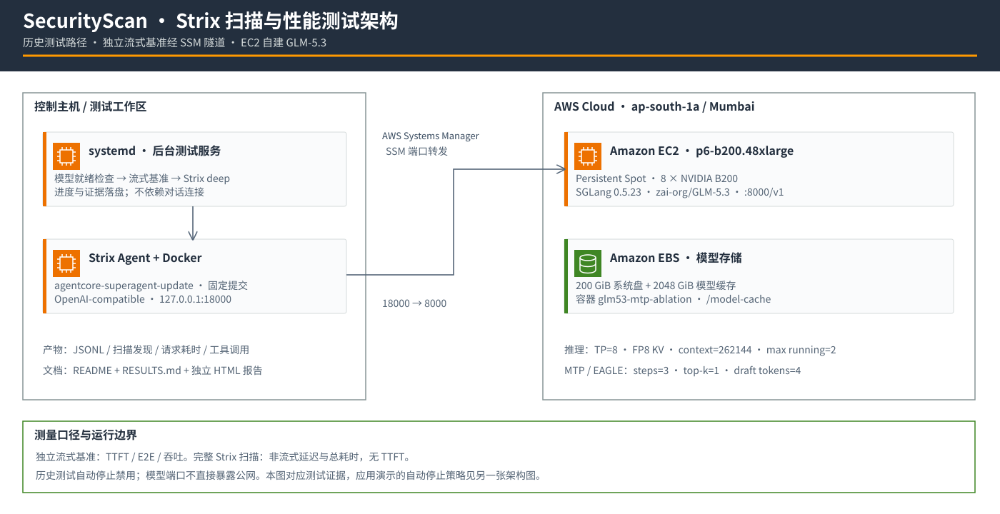

# GLM-5.3 on EC2 for Strix

## Retained multi-scenario deployment

Instance `i-0b33a1d2ee1a2065f` in `ap-south-1a` replaces the historical
deployment below. It uses a persistent Spot request with interruption behavior
**stop** and instance shutdown behavior **stop**. Both EBS volumes are retained.
The current console policy stops EC2 after ten minutes without activity,
protecting active scan jobs. Do not terminate it or cancel its Spot request.
User data runs only on first boot. The November 21 NVMe experiment adds
`glm53-nvme.service` to stage weights and start `glm53-nvme` at each boot.
The previous model container has restart policy `no`.
Model loading and Spot capacity can delay resumption.

### Local NVMe startup

The [November 21 startup experiment](../../reports/glm53-nvme-startup/RESULTS.md)
completed real inference in approximately 9m50s from initial staging.
NVMe container start to model discovery took 4m50s; the interrupted EBS
baseline was still unready after 16m44s. Copy retries reused partial data,
so this is not a controlled cold-start speedup measurement.

`nvme-start.py` copies `/model-cache/hub` to
`/opt/dlami/nvme/glm53-hf/hub` with eight parallel rsync file copies followed
by a metadata/symlink pass, preserving Hugging Face symlinks.
EBS remains the durable source. The existing DLAMI instance-store filesystem
is reused without formatting. Stop/start erases instance-store data, so the
approximately 704 GiB copy must be included in cold-start timing.

On the GPU host, run `sudo bash install-nvme.sh glm53 --next-boot` from this
directory for the H200 container (use `glm53-mtp-ablation` for the retained
B200 container). The default is `--next-boot`: installation captures the
original Docker configuration locally with mode 0600, disables its automatic
restart, and enables the systemd service without interrupting the running
container. On the next boot, the service stages the weights before starting
the replacement. Use `--now` only when scans are idle and an immediate
container switch is intended. The replacement uses the original image and
model parameters with the Hugging Face cache bind changed to NVMe.
Do not publish `/var/lib/glm53-nvme/original.json`; it can contain credentials.

On November 23, this next-boot configuration was installed on Tokyo H200
`i-09c41bc239b10b001` (`p5en.48xlarge`, eight H200 GPUs). Service enablement
and the existing model's HTTP 200 health response were verified. The November 23
scans completed with the EBS-backed container; NVMe serving and total cold-start
time on this H200 remain to be verified after the next startup.

Inspect `journalctl -u glm53-nvme.service` and
`/var/lib/glm53-nvme/timings.jsonl` for staging, model start, and readiness.
The service waits for the expected model in `/v1/models`; an actual generation
must also succeed before declaring inference verified. `copy_seconds` includes
the preceding original-container stop; `staging_seconds` measures copying and
filesystem flush. Compare total startup, not load time alone. Retries can reuse
partial copies, so retry durations are not full cold-copy measurements.

Rollback: `sudo systemctl disable --now glm53-nvme.service`, verify EBS is
mounted, then `sudo docker start glm53` on H200 or
`sudo docker start glm53-mtp-ablation` on B200.
This restores serving manually; reconfigure boot ownership before another restart.

`benchmarks/run-scenarios.sh` runs three isolated Strix audits.
`benchmarks/stream-benchmark.py` measures inference separately at its configured
endpoint. Earlier fixture measurements used GPU-host loopback; the larger
repository measurements use an SSM tunnel and include its overhead.
See `../../reports/glm53-multiscenario/` for earlier results and methodology.

`benchmarks/run-superagent.sh` audits four areas of the larger
agentcore-superagent-update checkout: authentication, file paths, webhooks,
and tool execution. It uses a 262144-token context and a 32768-token output
budget with low reasoning effort. The separate streaming benchmark accepts
source bundles generated by `benchmarks/build-source-cases.py`; these measure
model responses, not executed penetration tests.
The larger-repository results and independently checked findings are recorded
in `../../reports/glm53-superagent/RESULTS.md`.

`benchmarks/run-full-superagent.sh` runs a separate full-scope, deep Strix
source audit with a 150-turn limit and a three-hour timeout. It writes a log,
target revision and exit status under `reports/glm53-superagent/full-*`.
It requires a ready model endpoint (default: SSM tunnel on port 18000).
This non-streaming scan does not measure TTFT; use the streaming benchmark
separately. The current console idle policy above supersedes the earlier
instruction to keep the GPU running.

The November 21 run uses the user systemd units `glm53-full-suite.service`
and `glm53-test-tunnel.service` with lingering enabled. The suite waits up to
40 minutes for model readiness, verifies a tool-call round trip, runs three
repeats of the source streaming benchmark, and then starts the deep scan.
The automatic StopInstances `ExecStopPost` hook has been removed without
restarting the suite, and cancellation of the GPU host's scheduled shutdown
is recorded in resource-status.json. The 220-minute service limit bounds the
test process only; EC2 and the tunnel remain running afterward. Logs are in
`reports/glm53-superagent/full-20261121T033400Z/` relative to the repository root.
These suite details describe the earlier run; current idle shutdown is owned
by the console reaper.

On the retained instance's November 20 restart, asynchronous checkpoint loading
stalled with worker stacks in CUDA host-to-device copies. The temporary
`disable-async-weight-load.py` patch disables the loader's thread-pool branch.
Applying it inside the existing container and restarting allowed initialization
to advance to FlashInfer autotuning at 13:05 UTC. This is a local workaround,
not a confirmed upstream diagnosis. It changes the container filesystem and
must be reapplied after container recreation; the original file is backed up.

## Deployment status — 2026-11-20

The first Mumbai Spot instance failed bootstrap because installing `docker.io`
conflicted with the AMI's preinstalled `containerd.io`; it terminated.
The bootstrap now reuses preinstalled Docker. Replacement Spot instance
`i-0e45eeaa532318d93` launched in `ap-south-1a` at 05:20:29 UTC.
Model readiness and a complete tool-call roundtrip were verified at 05:51 UTC.
Eight B200 GPUs and SSM were verified healthy. A second bootstrap failure was caused
by duplicate NVMe aliases for the data EBS volume; canonicalizing device
paths fixed it in place. The 2 TiB data volume was mounted and SGLang served the scan.
The FP8 checkpoint contains 141 weight files (755,632,050,320 bytes), revision
`ba32f8c19c8738e2c57c71798c601d477a7bf844`. GPU, image, model and tool-call
evidence is saved in `../../reports/agentcoreshell-selfhosted/`.
The first scan reached the 18-turn limit; the retry used a 60-turn limit and
completed at 06:00:16 UTC (run `agentcoreshell_bc7c`, 41 model calls, exit 2:
findings). The reviewed finding is conditional task-to-shell injection; the
current repository only accepts operator CLI input, so remote exploitation
was not established. See
`../../reports/agentcoreshell-selfhosted/security-review.md`.
Termination was requested after saving scan artifacts. Consult cleanup
evidence in that report directory for the final resource state.

The account's 34 commercial regions were queried. Twenty were enabled;
six offered this instance across eleven availability zones. Fourteen
not-enabled regions could not be verified. See `region-availability.json`.
New offerings beyond the US were Mumbai (`ap-south-1a`, `ap-south-1c`),
Paris (`eu-west-3a`), and Stockholm (`eu-north-1b`). Launch attempts stopped
after the first Mumbai Spot request succeeded.

Requested instance: one `p6-b200.48xlarge`, preferring Spot.
Both Spot and On-Demand launch requests returned `InsufficientInstanceCapacity`
in all seven tested availability zones:

- `us-east-1d`
- `us-east-2a`, `us-east-2b`, `us-east-2c`
- `us-west-2a`, `us-west-2b`, `us-west-2d`

The earlier US attempts created no instances; their temporary resources
were removed. The Mumbai instance uses a new SSM role/profile and a
security group with no inbound rules. Unused Paris and Stockholm security
groups were removed. Local `state.json` records the historical instance and
API results; `state-retained.json` records the current retained deployment.

## Prepared configuration

`user-data.sh` prepares SGLang with `zai-org/GLM-5.3`, tensor parallelism
across eight GPUs, FP8 KV cache, a 262144-token context, and OpenAI-compatible
inference on port 8000. It schedules shutdown four hours after bootstrap
starts; launch configuration must set shutdown behavior to **stop**.
The script expects a fresh encrypted 2048 GiB EBS data volume.

`run-strix.sh` targets the local AgentcoreShell checkout and has been
validated against the self-hosted endpoint. It defaults to
`http://127.0.0.1:18000/v1` through an SSM port-forwarding session:

```bash
aws ssm start-session --region ap-south-1 --target i-0b33a1d2ee1a2065f \
  --document-name AWS-StartPortForwardingSession \
  --parameters '{"portNumber":["8000"],"localPortNumber":["18000"]}'
```

Before any new launch, check the current instance and refresh the launch
configuration. `launch.json` is a template: replace its explicit `REPLACE_WITH_`
fields with regional resource IDs and a unique client token. Its base64 user data
matches `user-data.sh`; regenerate it if that script changes.
Verify GPU health, checkpoint loading, and tool calls before
starting Strix. The console stops the instance after ten idle minutes; retained
EBS continues billing while EC2 is stopped.

References:

- https://cookbook.sglang.io/autoregressive/GLM/GLM-5.3
- https://recipes.vllm.ai/zai-org/GLM-5.3

## Deployment architecture and latest results (2026-11-21)



Full Strix deep scan completed in 704 seconds: 637/637 model requests succeeded, 611 tool calls, and 29 unverified findings. Independent streaming benchmarks completed 24/24 requests. See the [latest results](../../reports/glm53-superagent/RESULTS.md) and [standalone HTML](../../reports/glm53-superagent/index.html) for latency metrics and measurement limits.
