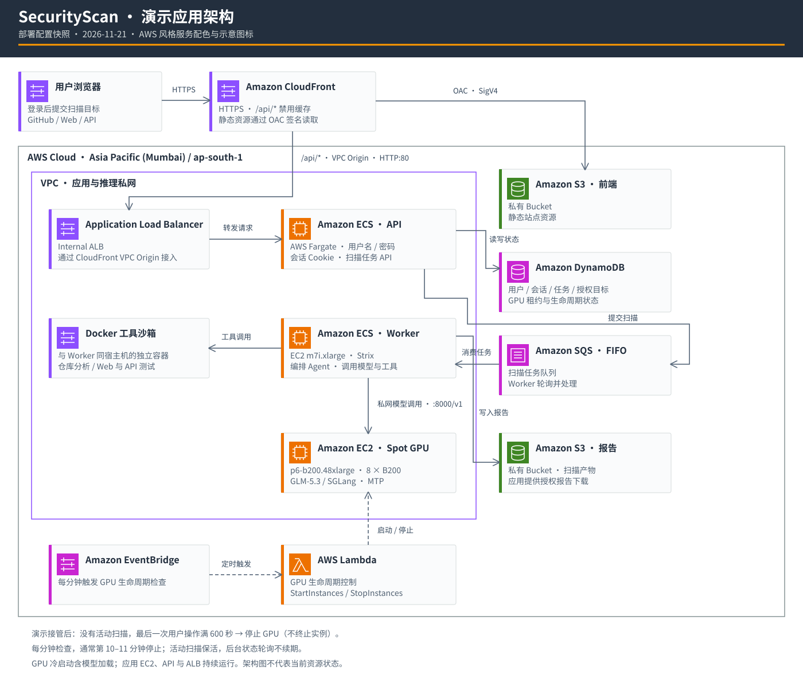
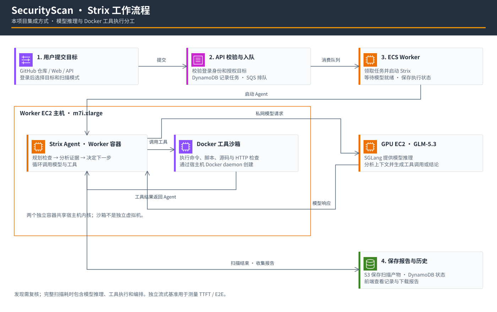
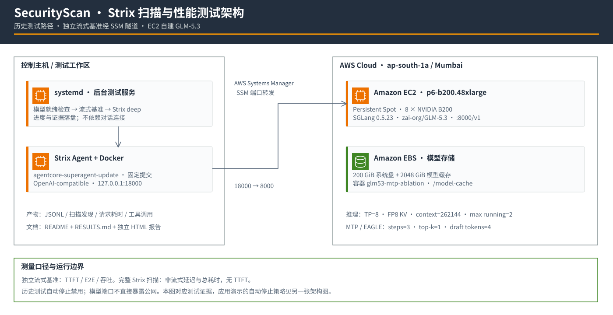

# GLM-5.3 自建推理与 Strix 仓库测试（更新于 2026-11-22）

## Strix + GLM-5.3 实际扫描性能（2026-11-22 汇总）

**扫描推理机型：AWS EC2 `p6-b200.48xlarge`，单机 8×NVIDIA B200（ap-south-1）。** 使用自建 GLM-5.3、SGLang 0.5.23、TP=8 和 MTP；下表为已完成的 Strix deep 扫描，工具在独立沙箱运行。

| 扫描场景 | 扫描 E2E | 成功模型请求 / 总请求 | 工具调用 | 单次模型请求 E2E 均值 | 待核验发现 |
| --- | ---: | ---: | ---: | ---: | ---: |
| agentcore-superagent-update 完整仓库 | 704 秒（11 分 44 秒） | 637 / 637 | 611 | 4.001 秒 | 29 |
| AgentcoreShell deep | 120 秒（2 分钟） | 66 / 66 | 66 | 1.829 秒 | 1 |
| superagent 前端与部署专项 deep | 781 秒（13 分 1 秒） | 575 / 575 | 559 | 2.847 秒 | 28 |

扫描 E2E 是扫描任务总墙钟耗时，包含模型、工具和编排，**不包含 GPU 启动和模型加载**；单次请求 E2E 是一次模型调用从发出到完整响应的耗时。请求可能并行，不能将均值乘以请求数当作扫描总耗时。上述请求为非流式，**未测得扫描内 TTFT 或 TPOT**。请求成功率不代表漏洞验证准确率；发现可能重叠，不应相加为独立漏洞数。

证据：[完整仓库扫描](full-20261121T033400Z/progress-summary.json)、[补充扫描](../glm53-additional-full/20261121T095600Z/progress.json)。

**H200 已完成的是独立流式推理基准，尚无完整 Strix 扫描成绩。** 机型为 `p5en.48xlarge`（8×NVIDIA H200，ap-northeast-1）。并发 1 / 2 时，请求 E2E 均值为 **13.740 / 15.407 秒**，TTFT 均值为 **0.140 / 0.184 秒**，聚合输出吞吐为 **203.93 / 341.99 tokens/s**（整台 8 卡实例）。共 24 次正式请求，另有 4 次预热请求不计入统计。B200 对应独立基准 E2E 为 10.220 / 11.111 秒；两组输出长度、调用路径和内核配置存在差异，不能据此推断纯硬件速度差异。详见 [H200/B200 对照报告](../glm53-h200-comparison/README.md)。

## 本地部署与运行

[本地部署指南](../../docs/local-deployment.md) 包含 Strix 安装、8×B200 上的 GLM-5.3 服务启动、模型连接、本地源码/GitHub/Web/API 扫描及报告查看。已有模型服务时，控制主机无需 GPU。基础启动示例未启用 MTP，与下文 MTP 实测配置有区别。

控制台前端可通过 `npm ci`、`npm run dev` 本地开发；完整登录与扫描仍依赖 AWS 后端及 HTTPS 同源配置。本地 CLI 没有空闲自动停止 EC2 的机制，结束后需要单独停止 GPU 实例。详细命令与前提见上述指南。

## 最新测试结论（2026-11-21）

**完整 Strix deep 扫描已完成，用时 704 秒（11 分 44 秒）；637/637 次模型请求成功，611 次工具调用。** 单次模型请求平均延迟为 **4.001 秒**。生成 **29 条待独立核验发现**：Critical 6、High 6、Medium 12、Low 4、Info 1。退出码 2 表示发现达到 fail-on 阈值；产物状态为 `completed`，不是模型调用失败。

目标为 `agentcore-superagent-update` 的固定提交 `0a20b8b14ab9abdf7301ec1e475be2d6dc2effde`。完成时间为 **2026-11-21 04:15 UTC**，运行 ID 为 `agentcore-superagent-update_e35b`。704 秒不包含模型加载（本次约 25 分钟）。发现尚未逐项核验，也不能与历史 32 条直接相加为独立漏洞数。

### 演示应用部署架构

前端由私有 S3 + CloudFront OAC 提供；用户先以用户名、密码登录。`/api/*` 通过 CloudFront VPC Origin 转发至内部 ALB 和 ECS Fargate API，任务进入 SQS FIFO，由 ECS EC2 Worker 运行 Strix 与 Docker 工具沙箱。Worker 通过私网调用 Spot GPU 上的 GLM-5.3，扫描产物写入私有 S3；DynamoDB 保存账户、会话、任务、授权目标及 GPU 租约。

演示接管 GPU 后，EventBridge 每分钟触发 Lambda 检查空闲状态。没有活动扫描时，最后一次用户操作满 600 秒后执行 `StopInstances`，通常在第 10–11 分钟停止；后台状态轮询不会延长租约。活动扫描保活，显式结束演示或最后任务结束后的空闲倒计时为 10 分钟。停止保留实例和 EBS。模型加载需要单独等待，历史一次冷启动约 25 分钟，Spot 启动受容量影响。此图依据 2026-11-21 部署配置和记录绘制，不表示实时运行状态；历史测试结果与当前应用验证记录分别记录。

架构图使用 AWS 服务分类配色和自绘矢量图标；应用推理走私网，以下历史性能测试走 SSM 隧道。HTML 内嵌 SVG，可离线查看。更新图表可运行 `python3 scripts/render_architecture.py`，然后运行 `uv run scripts/render_report.py`。

### Strix 工作原理与工具沙箱

Strix 是由大模型驱动的安全测试 Agent。它根据目标规划检查步骤，调用工具收集证据，将执行结果交给模型分析，再决定下一步测试，最后生成报告。本项目由 ECS Worker 启动 Strix；GLM-5.3 通过 GPU 实例上的 SGLang 服务提供推理。

| 组件 | 在本项目中的职责 |
| --- | --- |
| Strix / ECS Worker | 消费队列任务、组织 Agent 执行、调用模型与工具、收集报告 |
| Docker 工具沙箱 | 执行源码读取、命令、脚本和网络测试；工具的实际执行环境 |
| GLM-5.3 / GPU EC2 | 分析上下文并生成下一步工具调用或结论；模型服务与工具执行分开 |
| API / DynamoDB / S3 | 校验用户与目标、保存任务和历史状态、提供报告下载 |

**工具沙箱是 Docker 容器。** Worker 通过宿主机 Docker daemon 创建沙箱，Worker 容器和沙箱是同一 EC2 主机上的独立容器；它不是独立虚拟机，也不运行在 GPU 实例内。容器提供工具依赖和进程、文件系统隔离，但共享宿主机内核。本演示环境适合受信任管理员使用；目标授权列表不是完整的网络出口隔离。

支持的任务入口包括 GitHub 仓库、Web 和 API：仓库扫描分析源码中的认证、权限、输入处理和依赖使用；Web/API 测试根据目标和可用上下文执行 HTTP 交互与漏洞验证。具体覆盖范围取决于目标可达性、工具、凭据和执行预算，不能保证每次扫描覆盖全部漏洞类型。目前没有私有仓库凭证或专用 API 凭证输入表单。

用户登录后提交授权目标，API 校验并入队；Worker 等待并调用模型，在沙箱中循环执行测试，结束后保存报告。关闭页面不会取消后台任务。管理员可在前端“授权目标”中管理仓库与 Web/API 主机列表，配置保存到 DynamoDB；其他用户无修改权限。

报告中的发现需要独立复核。扫描总耗时包含模型、工具和编排开销；当前完整扫描使用非流式模型请求，不能从中得到 TTFT。本文的流式 TTFT/E2E 数值来自独立基准。

参考：[Strix CLI](https://docs.strix.ai/usage/cli)、[Strix 文档索引](https://docs.strix.ai/llms.txt)。上图描述本项目集成方式。

### 本轮测试部署架构

SGLang 0.5.23 自建服务启用 MTP（EAGLE，steps=3、top-k=1、draft tokens=4），TP=8、FP8 KV cache、context=262144、并行请求上限 2。控制主机通过 SSM 将本机 18000 转发到 GPU 8000；后台 systemd 服务将进度和证据落盘。本轮测试时 GPU 保持运行，自动停止已禁用；[资源记录](resource-status.json)中的 `running` 是带时间戳的观察值。

### 最新独立流式性能（MTP，经过 SSM）

| 并发 | 成功请求 | TTFT 均值 / P95（秒） | 首次正文均值（秒） | E2E 均值 / P95（秒） | 估算 TPOT 均值（毫秒） | 聚合输出 tokens/s |
| --- | ---: | ---: | ---: | ---: | ---: | ---: |
| 1 | 12/12 | 0.325 / 0.372 | 4.353 | 10.220 / 18.186 | 3.653 | 263.3 |
| 2 | 12/12 | 0.337 / 0.423 | 4.973 | 11.111 / 17.318 | 4.209 | 447.5 |

认证、路径、Webhook、工具四类源码审计，每类每并发重复 3 次，输出预算 8192、reasoning=low；24 次请求均无错误、截断或仅思考输出。并发 2 提高聚合吞吐，但单请求平均 E2E 略增。TTFT 取首个非空 reasoning/content/tool 增量，首次正文单列；E2E 从请求发出计至完整响应流结束。吞吐包含思考 tokens。

**完整 Strix 扫描采用非流式请求，没有 TTFT 测量；上表是独立基准，不能当作完整扫描指标。** 每档仅 12 个样本，P95 仅供参考；与历史实验及 InferenceX 的预算、缓存、硬件和负载不一致，不能直接排名或据此计算 MTP 加速比。Codex 对话断流仍未证实修复。

证据：[完整扫描摘要](full-20261121T033400Z/README.md)、[结构化汇总](full-20261121T033400Z/progress-summary.json)、[流式指标](full-20261121T033400Z/stream-metrics-public.jsonl)。

### 补充完整扫描（2026-11-21）

| 场景 | 扫描耗时（秒） | 成功模型请求 | 工具调用 | 请求平均 / P95（秒） | 待核验发现 |
| --- | ---: | ---: | ---: | ---: | ---: |
| AgentcoreShell deep | 120 | 66/66 | 66 | 1.829 / 4.511 | 1 |
| Superagent 前端与部署 | 781 | 575/575 | 559 | 2.847 / 8.985 | 28 |

两次扫描均完成，采用自建 GLM-5.3、TP8 和 MTP，顺序执行。请求延迟为非流式调用的 E2E，无法从中推导 TTFT；发现尚未独立核验，不与其他扫描相加为独立漏洞总数。详见[补充扫描摘要](../glm53-additional-full/20261121T095600Z/README.md)。

## 历史测试环境与证据（2026-11-20）

- 仓库：`https://github.com/milan9527/agentcore-superagent-update`，提交 `0a20b8b14ab9abdf7301ec1e475be2d6dc2effde`，本地约 56 MB。
- 模型：`zai-org/GLM-5.3`，revision `ba32f8c19c8738e2c57c71798c601d477a7bf844`。本轮为 EC2 自建 SGLang 推理，非 Bedrock 托管调用。
- GPU：`p6-b200.48xlarge`，8×B200，`ap-south-1a`，持久型 Spot `i-0b33a1d2ee1a2065f`。
- SGLang 镜像：`lmsysorg/sglang@sha256:f832b5c39559c9caa900b22ad37c76fcce66470676855c42052102c537812f1f`。
- 配置：TP=8、FP8 KV cache、context=262144、max-running-requests=2、mem-fraction-static=0.85、chunked-prefill-size=32768；关闭异步权重加载使启动成功，但尚未证明其故障根因。
- 模型识别与工具调用证据：[inference-verification.json](inference-verification.json)。

## 历史四场景 Strix 执行结果（2026-11-20）

四个场景均记录 `scan_completed=true`，共 770 次模型请求记录成功。退出码均为 2；完成状态依据扫描产物判断，而非将其当作退出码 0。原始发现含重复项，不能等同于已确认漏洞数。

| 场景 | 用时（秒） | 请求数 | 请求延迟 p50 / p95（秒） | 原始发现数 |
| --- | ---: | ---: | ---: | ---: |
| 认证与授权 | 372 | 175 | 1.904 / 11.088 | 13 |
| 路径与文件 | 752 | 242 | 2.082 / 15.440 | 5 |
| Webhook | 417 | 153 | 1.794 / 8.260 | 3 |
| 工具与执行 | 414 | 200 | 2.094 / 12.687 | 11 |

这些请求使用非流式调用，因此没有可用于计算 TTFT 的事件。扫描耗时包括代理及工具运行，不能当作单次推理 E2E。

发布证据：[扫描汇总](scan-summary.json)。汇总省略逐请求 usage 和本地原始报告路径；完整扫描日志、模型生成的未核验报告及目标源码保留在本地。

## 独立核验

1. **WebSocket 订阅缺少鉴权：隔离本地复现。** 使用仓库原始 `execution.gateway.ts`，不发送凭证，订阅已知的合成 executionId 后收到合成工作流事件。网关注册和订阅逻辑没有验证身份及执行所有权。实际部署风险还取决于外层入口鉴权、executionId 可获得性等条件。建议在握手认证，并在每次订阅时验证执行记录所属用户/租户。
   - [复现代码](validation/websocket-local-proof.ts)、[结果](validation/websocket-local-proof.json)。未访问真实用户数据，也未测试公网部署。
2. **Python ZIP 路径穿越：本地证据与扫描结论矛盾。** 对 `python -m zipfile -e` 构造 `../marker.txt`，Python 3.9.25 将路径规范化在提取目录内，目录外文件不存在。原始工具场景 vuln-0005 的复现主张不能采信；尚未测试生产 Python 版本或其他解压分支。
   - [结果](validation/zipfile-traversal.json)、[解释器实现](validation/zipfile-extract-member-source.txt)。

其余发现未完成独立验证。模型生成的 PoC 描述及 CVE 编号均应逐项核验，不宜直接作为可利用漏洞发布。

## 历史流式性能测试方法

另用四份实际源码包做只读审计请求，分别覆盖认证、路径、Webhook、工具，输入约 9399 / 27662 / 11281 / 17698 tokens。每个场景在并发 1 和 2 下各重复 5 次，共 40 次正式请求，另有一次排除统计的预热。

- 输出预算 32768 tokens，reasoning_effort=low，temperature=0。该预算与推理档位降低了先前 8192/high 配置中思考耗尽输出预算的风险；由于输入也发生变化，不能将差异归因于单个参数。
- TTFT：首个内容、思考或工具增量；首次可见正文另记 first_visible_s。
- E2E：请求开始至完整响应流结束，包含终止事件接收。
- TPOT：以生成 token 数估算；SSE 分块并非逐 token，结果是近似值。
- 指标由客户端经过 SSM 隧道测量，包含网络及隧道开销。重复输入可能命中缓存；未控制冷缓存。
- 每个并发档只有 20 个样本，p95 为插值估计。非 InferenceX 同协议实验，不能直接用于与其排名比较。
- `useful_completion` 只表示存在正文、正常 stop 且无协议错误，不代表审计结论正确。

## 历史流式性能结果

40/40 次正式请求均正常结束并产生正文；错误、截断和仅思考无正文均为 0。

| 并发 | 请求数 | TTFT p50 / p95（秒） | 首次正文 p50 / p95（秒） | E2E p50 / p95（秒） | 聚合输出 tokens/s |
| --- | ---: | ---: | ---: | ---: | ---: |
| 1 | 20 | 0.353 / 1.019 | 7.131 / 15.504 | 18.819 / 31.819 | 127.19 |
| 2 | 20 | 0.339 / 0.400 | 7.330 / 18.137 | 19.135 / 37.275 | 236.18 |

并发 1 / 2 的 e2e p50 分别为 18.819 / 19.135 秒；近似 TPOT p50 分别为 7.641 / 8.094 毫秒。吞吐量为该批所有输出 tokens 除以批次墙钟时间，包含思考 tokens，不能当作每请求正文生成速度。

请求指标和汇总：[stream-metrics.jsonl](stream-metrics.jsonl)、[stream-summary.json](stream-summary.json)。发布的请求指标仅移除模型回答正文，保留预热标记、时序和 token 用量；统计排除预热。此次样本证明 32768 输出预算与 low 推理配置下能够完成这些源码审计请求，不能保证更大任务永不耗尽预算。Strix 上下文与输出预算覆盖参数的相关测试此前已通过（22 项）。

## 精简输出与 MTP 独立对照（已完成）

三组共享相同模型、源码和输出预算，精简组只追加格式要求，MTP 组只启用 NextN/EAGLE；没有同时叠加两项优化。每组 40 次正式请求和 4 次预热，正式请求共 **120/120 正常结束且有正文，错误和截断均为 0**。这次在 GPU 实例 localhost 测量，与上面的历史 SSM 测量分开。

| 组别 | 并发 | 请求数 | E2E 均值 / p50 / p95（秒） | 相对基线均值 | TPOT 均值（毫秒） | 聚合输出 tokens/s |
| --- | ---: | ---: | ---: | ---: | ---: | ---: |
| baseline | 1 | 20 | 19.65 / 19.52 / 28.53 | — | 8.197 | 121.38 |
| concise | 1 | 20 | 15.78 / 15.12 / 21.71 | −19.7% | 8.197 | 121.30 |
| mtp | 1 | 20 | 8.64 / 7.07 / 14.20 | −56.0% | 3.476 | 284.01 |
| baseline | 2 | 20 | 19.64 / 20.53 / 28.09 | — | 8.594 | 227.43 |
| concise | 2 | 20 | 17.24 / 14.95 / 28.08 | −12.2% | 8.587 | 225.72 |
| mtp | 2 | 20 | 9.89 / 9.04 / 15.22 | −49.6% | 4.023 | 482.07 |

| 组别 | 并发 | TTFT 均值 / p50 / p95（秒） | 首次正文均值（秒） | E2E 均值（秒） | 平均输出 / 思考 tokens | 平均正文字符数 |
| --- | ---: | ---: | ---: | ---: | ---: | ---: |
| baseline | 1 | 0.067 / 0.065 / 0.072 | 7.868 | 19.655 | 2385.6 / 948.9 | 5714.9 |
| concise | 1 | 0.071 / 0.071 / 0.072 | 0.330 | 15.784 | 1914.7 / 32.4 | 7704.5 |
| mtp | 1 | 0.073 / 0.070 / 0.082 | 3.622 | 8.644 | 2454.9 / 983.2 | 5831.3 |
| baseline | 2 | 0.071 / 0.064 / 0.115 | 7.150 | 19.643 | 2275.9 / 822.9 | 5780.2 |
| concise | 2 | 0.071 / 0.071 / 0.073 | 0.595 | 17.245 | 1998.0 / 61.8 | 7926.9 |
| mtp | 2 | 0.160 / 0.074 / 0.930 | 4.389 | 9.895 | 2415.9 / 1007.4 | 5540.2 |

**结论：MTP 是本次更有效的 E2E 优化。** 并发 1 / 2 的 TPOT 分别降低 57.6% / 53.2%，即使平均输出 tokens 增加 2.9% / 6.2%，请求仍明显变快。服务日志确认加载 GLM NextN，TP0 的接受长度约 2.40–2.65、接受率约 0.47–0.55。不过，并发 2 的 TTFT p95 从 0.115 秒升至 0.930 秒，不能声称所有延迟指标均改善。

**精简指令缩短了思考，并没有缩短正文。** 思考 tokens 减少约 96.6% / 92.5%，正文字符数反而增加约 34.8% / 37.1%；TPOT 基本不变。它提前呈现正文、降低总输出和平均 E2E，但不能将其解释成“正文压缩成功”。并发 2 的 E2E p95 几乎没有改善。

人工阅读了三组每场景、每并发的首份响应，共 24 份。核心源码风险有保留，但各组均存在前提遗漏、错误验证建议和未经执行就声称观察到结果的问题；没有证明质量无损。MTP 路径响应仍出现 Python Zip Slip、默认 Git 行为的错误主张，个别修复建议把路径相对计算参数写反。详见 [质量核验](ABLATION-QUALITY.md)。本轮没有执行这些响应中的 PoC，也不是完整 Strix 工具循环的加速测量。

固定按 baseline → concise → mtp 执行，非随机交错；每场景/并发只有 5 次，汇总每格 20 次。每组清空缓存后预热，测试代表重复审计负载。模型加载不计入请求时间，TPOT 是客户端流式估算。与 InferenceX 的模型版本、量化、缓存命中、输入输出长度和硬件条件未对齐，不能直接排名；此前参考数据中的 B200 条目是 GLM-5.2，B300 条目才是 GLM-5.3。

复现与证据：[实验协议](ABLATION-PROTOCOL.md)、[统计汇总](ablation-20261120/comparison.json)、[baseline 指标](ablation-20261120/baseline-metrics.jsonl)、[concise 指标](ablation-20261120/concise-metrics.jsonl)、[MTP 指标](ablation-20261120/mtp-metrics.jsonl)。公开指标移除回答正文；原始答案与运行日志已保存在本地和私有 S3 备份，供复核。

## Codex 对话断流

`stream closed before response.completed` **仍未证实修复**。这是 Codex 到其模型提供方的连接，与本轮自建 GLM 推理链路不同。后台扫描完成不代表对话流故障解决。已保留请求 ID、时间和配置限制：[故障记录](stream-incident-20261120.md)。需要服务端按请求 ID 关联调查，现有证据不足以确定断开连接的具体环节。

## 历史资源收尾（2026-11-20）

120 次正式对照请求完成后，结果归档并验证上传至私有 S3。2026-11-20 16:22:29 UTC 调用 `StopInstances`，随后 `DescribeInstances` 已确认 GPU 实例 **stopped**。未执行 terminate，未取消持久型 Spot。两块 EBS（200 GB 根盘和 2048 GB 模型缓存盘）保留，DeleteOnTermination=false，仍产生存储费用。最新观察及备份校验见 [resource-status.json](resource-status.json)。

2026-11-21 本轮完整扫描时已重新启动并保持运行；上述停止记录仅描述历史实验收尾。
